<!-- Every card is an animated SVG drawn by scripts/render_cards.py and refreshed daily by
     .github/workflows/profile-cards.yml. Spacing is baked into the SVGs, so keep this block free of
     blank lines and keep the cards in a row on one line with no spaces between them. -->

 
 
 
 
<picture><source media="(prefers-color-scheme: dark)" srcset="./cards/title-dark.svg" /></picture> 
<!-- cards:repos:start -->

<!-- cards:repos:end -->

<a href="https://sureshmathav-inuk.vercel.app">sureshmathav-inuk.vercel.app</a> &nbsp;/&nbsp; <a href="https://www.linkedin.com/in/suresh-mathav">linkedin</a> &nbsp;/&nbsp; <a href="mailto:sureshmathav123@gmail.com">email</a> &nbsp;/&nbsp; <a href="https://github.com/Sureshmathav2004">github</a>

